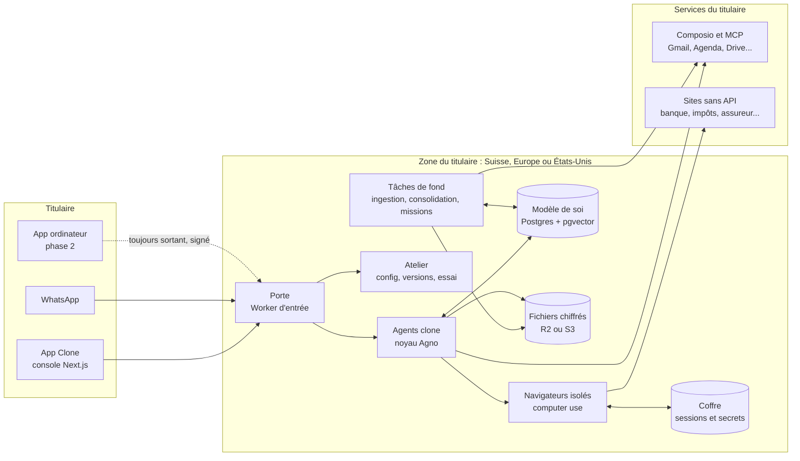

# 02. Les bases techniques

Le clone est un agent MEGGA. On garde le socle (Agno, le noyau, l'atelier, la porte, les zones) et on ajoute ce qui manque pour une personne plutôt qu'une entreprise. Ce fichier dit ce qu'on réutilise, ce qu'on ajoute, et la grande décision qu'impose le grand public.

## Vue d'ensemble



## Ce qu'on réutilise tel quel ou presque

| Existant | Où | Ce qu'il apporte au clone |
|---|---|---|
| La boucle de l'agent, le secours de modèle, le cache de Claude | `noyau/agent.py`, `noyau/tour.py` | le cœur de chaque tour |
| WhatsApp, vocaux, voix, regroupement des messages | `noyau/whatsapp.py`, `noyau/voix.py`, `noyau/oral.py` | parler à son clone, recevoir le point du jour en vocal |
| La mémoire par personne, le fil, les rappels | `noyau/memoire.py`, `noyau/fil.py`, `noyau/rappels.py` | la première couche du modèle de soi, les missions planifiées |
| Les garde-fous, le plafond, le masquage des secrets | `noyau/garde.py`, `noyau/typographie.py` | protéger la facture et les données |
| Composio, outil par outil | `noyau/composio.py`, `atelier/routes_composio.py` | les mains du clone dans Gmail, Agenda, Drive, Notion... |
| L'entrée par API | `noyau/api.py`, `docs/api.md` | l'app et l'app ordinateur parlent au clone sans WhatsApp |
| L'atelier : versions, essai, mise en service, retour | `atelier/` | la configuration du clone, versionnée comme celle d'un agent d'entreprise |
| Stripe, forfaits, recharges | `atelier/stripe.py`, `atelier/forfaits.py` | l'abonnement grand public |
| Le relevé chiffré, les alertes, sans contenu | `noyau/suivi.py`, `atelier/alertes.py` | suivre la santé de chaque clone sans rien lire |
| Le pilote : toujours sortant, ordres signés Ed25519 | `pilote/`, `noyau/pilotage.py` | le modèle exact pour l'app ordinateur (C8) |
| Les zones et l'image unique signée | `docs/plan.md`, `socle/` | la souveraineté, dès le premier jour |
| La console : Better Auth, CopilotKit, AG-UI, shadcn | `console/` | l'app Clone et l'onboarding conversationnel |
| Les approbations et le journal d'audit | branche `megga/lot-9-1-approbations` (pas sur `main`) | la file « À valider » : à porter sur `main` en C4 |

## Ce qu'on ajoute

| Nouveau | Où (proposé) | Rôle |
|---|---|---|
| Le métier `clone` | `noyau/config.py` (`METIERS`), `atelier/gabarits/` | un agent au service d'une personne, avec ses réglages propres |
| Le pack clone | `packs/clone/` | les outils du clone : missions, portrait, règles, file « À valider », point du jour |
| Le modèle de soi | tables déclarées dans `noyau/stockage.py`, logique dans `packs/clone/soi/` | la grande base de la personne ([04-modele-de-soi.md](04-modele-de-soi.md)) |
| L'agent d'accueil | `packs/clone/accueil/` | mène l'entretien d'onboarding et écrit la configuration ([03-onboarding.md](03-onboarding.md)) |
| L'ingestion | tâches de fond (`packs/clone/ingestion/`) | lit l'historique (mails envoyés, agenda, documents) et nourrit le modèle de soi |
| La consolidation | tâche de nuit | fond les doublons, lève les contradictions, prépare les questions au titulaire |
| La politique d'autonomie | `packs/clone/autonomie.py` | décide pour chaque action : agir, proposer ou refuser ([05-actions.md](05-actions.md)) |
| Le navigateur dans le cloud | un service à part, par zone | les sites sans API, avec les sessions du titulaire |
| Le coffre | par zone, chiffré par titulaire | sessions de navigateur, identifiants de sites, jamais lus par le modèle |
| Les recettes | table du modèle de soi | les procédures apprises sur un site, rejouées |
| Les notifications | atelier ou porte | « 2 actions à valider », web push puis mobile |
| L'inscription libre | atelier | un titulaire crée son compte et son clone seul (aujourd'hui, `POST /clients` est réservé à MEGGA) |

**La règle du dépôt tient toujours** : un seul module du noyau parle à la base (`noyau/stockage.py`). Les tables du modèle de soi y sont déclarées et versionnées comme les autres, les tests tournent aussi sur SQLite.

## La configuration d'un clone (esquisse)

Le clone garde le même format de configuration (`Config`), avec `metier: clone` et une section `clone` de plus. Tout ce que l'onboarding apprend de la personne va dans le modèle de soi, pas dans la configuration : la configuration dit **comment le clone travaille**, le modèle de soi dit **qui est la personne**.

```yaml
version: 2
id: t-7f3c9a          # identifiant opaque, jamais le nom ni le courriel
nom_agent: Clone       # le titulaire peut le renommer
entreprise: Camille Martin
zone: europe
langue: fr
fuseau: Europe/Paris
metier: clone
outils: [clone, connecteurs, navigateur]
modeles:
  principal: claude-sonnet-5-5
  secours: null        # voir « Les modèles » plus bas
memoire: {outils: true, montres: 40}
clone:
  canaux: [app, whatsapp]
  point_du_jour: {matin: "07:30", soir: null, vocal: true}
  domaines:
    mails:          {autonomie: {lire: agir, preparer: agir, envoyer: proposer}}
    agenda:         {autonomie: {lire: agir, preparer: agir, envoyer: agir}}
    administratif:  {autonomie: {lire: agir, preparer: agir, envoyer: proposer, engager: refuser}}
    achats:         {autonomie: {lire: agir, preparer: proposer, engager: refuser}}
  transparence:
    signature_ia: discrete     # aucune, discrete, explicite (voir 07)
    voix_signalee: true        # toujours vrai : non réglable
  regles_dures: []             # ajoutées par le titulaire, en langage naturel, puis normalisées
composio:
  outils: [GMAIL_FETCH_EMAILS, GMAIL_CREATE_EMAIL_DRAFT, GMAIL_SEND_EMAIL, GOOGLECALENDAR_FIND_FREE_SLOTS, GOOGLECALENDAR_CREATE_EVENT]
```

Le passage à `version: 2` de la configuration suit la règle du dépôt : une valeur par défaut ne change jamais sans changer `VERSION`.

## La grande décision : passer au grand public

Aujourd'hui, chaque client a **son conteneur, éveillé jour et nuit** (environ 7 $ par mois, décision du 17.11.2026, parce qu'un réveil prenait une à deux minutes) et **sa base Postgres**. C'est juste pour quelques dizaines d'entreprises ; ce n'est pas tenable pour des dizaines de milliers de personnes, dont la plupart n'ont besoin de leur clone que quelques minutes par jour.

| Option | Calcul | Données | Pour | Contre |
|---|---|---|---|---|
| **A. Comme aujourd'hui** | un conteneur par titulaire | une base par titulaire | isolation parfaite, rien à changer | environ 7 $ par mois et par titulaire avant tout modèle ; réveils lents |
| **B. Un pool partagé** (recommandé) | des conteneurs sans état, communs à une zone, qui servent n'importe quel titulaire | une base par zone, chaque ligne marquée du titulaire, sécurité par ligne (RLS) et chiffrement par titulaire | coût proportionnel à l'usage ; pas de réveil ; même image | l'isolation repose sur la base et les clés, plus sur le processus : à tester sans relâche |
| **C. Un objet par titulaire** | pool comme B | un Durable Object (SQLite) par titulaire chez Cloudflare | isolation forte et bon marché ; dans la ligne du plan (SQLite chez Cloudflare vers la centaine de clients) | la zone Suisse n'est pas chez Cloudflare ; pgvector à remplacer ; deux moteurs à tenir |

**Retenu : B, en cellules**, en gardant C possible (Thomas a confié la conception à Claude le 21.11.2026 ; le détail, à valider par Julien, est dans [09-infrastructure.md](09-infrastructure.md)).

- **Le calcul** : le noyau sait déjà servir plusieurs personnes (`user_id` d'Agno). Il faut qu'il sache servir **plusieurs titulaires** : la configuration et les outils d'un titulaire sont chargés au début du tour (avec un cache court), jamais gardés dans l'état du processus.
- **Les données** : chaque table du modèle de soi porte `titulaire`, la base applique la sécurité par ligne (un rôle de connexion par requête, `SET app.titulaire`), et les contenus sensibles sont chiffrés avec une clé propre au titulaire (une clé de données, elle même chiffrée par une clé de la zone). Effacer un titulaire, c'est effacer ses lignes **et** détruire sa clé.
- **L'interface du stockage** reste la seule porte vers la base : passer à C plus tard ne touchera que `noyau/stockage.py`.
- **Les agents d'entreprise ne changent pas** : ils restent en A. Un titulaire « premium » (zone Suisse, exigences fortes) peut aussi avoir sa propre installation.

Un essai de charge en C1 doit montrer qu'aucune requête ne lit jamais une ligne d'un autre titulaire, même avec un bug volontaire dans le code de l'agent. Les pools, le coordinateur par titulaire, les cellules, les clés, la zone Suisse et le dimensionnement : [09-infrastructure.md](09-infrastructure.md).

## Les tâches de fond

Le clone ne fait pas que répondre : il lit, apprend et agit sans qu'on lui parle.

| Tâche | Quand | Durée | Comment |
|---|---|---|---|
| Ingestion initiale | à l'onboarding, puis à chaque nouveau compte branché | minutes à heures | par lots, reprise après panne, progression visible dans l'app |
| Surveillance | à chaque nouveau mail, événement, message | secondes | déclencheurs des connecteurs (webhooks de Composio, ou relève régulière) |
| Missions planifiées | à l'heure dite | variable | l'alarme de la porte, déjà là pour les rappels (`triggers.crons`) |
| Consolidation | chaque nuit, heure du titulaire | minutes | petit modèle, par titulaire actif |
| Questions au titulaire | une ou deux par jour au plus | | posées dans le point du jour |

Ces tâches passent par une file tenue dans Postgres, la même dans toutes les zones, écrite dans la même transaction que ce qui la provoque, avec un tirage équitable par titulaire : une ingestion énorme ne doit pas ralentir les autres (voir [09-infrastructure.md](09-infrastructure.md), « La file »).

## Les modèles

| Usage | Modèle proposé | Pourquoi |
|---|---|---|
| Extraction, tri, classement, consolidation, embeddings, transcription, tâches simples | **modèles maison** (ouverts, servis par MEGGA dans la zone) | les données brutes ne sortent pas ; volume énorme |
| Tout ce qui touche une donnée sensible (classe A) | **modèles maison**, dont un grand modèle pour les tâches difficiles | jamais dehors, même pseudonymisé |
| Rédiger comme le titulaire, agir, décider (classe B) | Claude Sonnet 5.5, **sur du texte pseudonymisé seulement** ; ou modèles maison en niveau Strict | la meilleure qualité, sans données en clair |
| Décisions délicates, rédaction difficile | Claude Opus 5.5, à la demande, pseudonymisé | rare, cher, à mesurer |
| Le navigateur | recettes sans modèle ; sinon page pseudonymisée pour Claude, ou vision maison sur les sites sensibles | voir 05 et 12 |

Tout passe par **une passerelle unique**, seule sortie permise vers un modèle, qui classe, pseudonymise et refuse en cas de doute : la stratégie complète est dans [12-confidentialite.md](12-confidentialite.md).

**Le secours DeepSeek** (`deepseek-v4-pro`, défaut des agents d'entreprise) n'est **pas** proposé par défaut pour un clone : les données d'une personne (mails, santé, finances, proches) ne doivent partir que chez un fournisseur que sa zone permet. Le secours d'un clone est un autre modèle Claude, ou Claude par une autre voie (AWS Bedrock en Europe). À trancher par Julien.

## Ce que coûte un clone (à mesurer, pas à deviner)

Les postes, pour un titulaire et par mois : les tours du clone (modèle), l'ingestion (beaucoup de jetons au début, peu ensuite), la surveillance des nouveaux mails (un petit modèle par mail), les minutes de navigateur, la voix, le stockage chiffré. Le relevé chiffré mesure déjà les jetons par modèle et le coût de chaque jour (`GET /releves`) : il suffit d'y ajouter les minutes de navigateur et les tâches de fond. La grille et le calcul de chaque offre sont dans [10-tarifs.md](10-tarifs.md) ; les poids des crédits se recalent après C4, sur des chiffres réels.

## Le suivi sans contenu

Comme pour les agents d'entreprise : MEGGA voit l'état, les volumes, les coûts, les échecs et les alertes de chaque clone, jamais ce qu'il lit, écrit ou retient. Les nouvelles mesures : actions par domaine et par genre, part des actions validées sans retouche, injections détectées, recettes en échec, minutes de navigateur.
