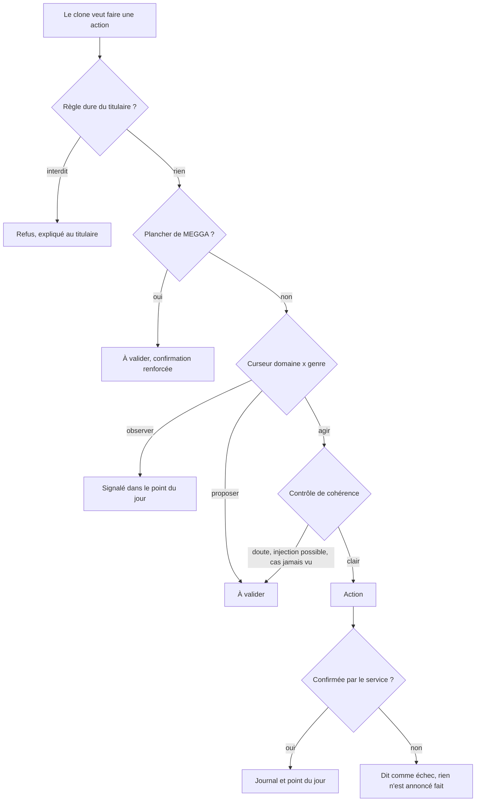

# 05. Les mains du clone, et ce qu'il a le droit d'en faire

## Quatre façons d'agir, de la plus sûre à la plus large

| Couche | Pour | Comment | Lot |
|---|---|---|---|
| **1. Connecteurs** | les services qui ont une API : Gmail, Outlook, Google Agenda, Drive, Notion, Slack, banques ouvertes... | Composio (déjà dans le noyau), outil par outil | C4 |
| **2. Serveurs MCP** | les services qui publient leur propre serveur MCP, ou ceux qu'on écrit | client MCP d'Agno, serveurs distants autorisés un par un | C4 |
| **3. Navigateur dans le cloud** | les sites sans API ni MCP : espaces clients, portails administratifs, assureurs, opérateurs | un navigateur isolé par titulaire, piloté par un modèle (computer use), avec les sessions du titulaire | C6 |
| **4. App sur l'ordinateur** | les logiciels installés, les fichiers locaux, les sites qui refusent les navigateurs du cloud | une petite app qui reçoit des ordres et pilote le vrai poste | C8 |

**La règle de choix** : le clone prend toujours la couche la plus sûre qui sait faire la tâche. Une API vaut mieux qu'un navigateur : plus rapide, moins chère, plus fiable, et l'action est confirmée par le service.

### Ce qui existe déjà pour les apps sans connecteur

Thomas l'a relevé : on trouve aujourd'hui des skills et des plugins qui donnent à un agent l'accès à une app sans connecteur MCP officiel. On s'en sert de trois manières :

1. **Les catalogues** : Composio couvre déjà plus de mille boîtes d'outils ; d'autres catalogues de serveurs MCP existent. Avant d'écrire quoi que ce soit, on cherche.
2. **Les connecteurs qu'on écrit nous mêmes** : pour un service très demandé sans connecteur, MEGGA écrit un petit serveur MCP (sur l'API privée documentée du service, ou par navigateur derrière), revu et testé, puis le met au catalogue de tous les clones.
3. **Les recettes apprises** : pour la longue traîne (le site de la mutuelle de Camille), le navigateur apprend la procédure une fois, la garde comme recette, et la rejoue. Une recette qui marche chez beaucoup de titulaires (sans aucune donnée personnelle) peut devenir commune.

Aucun skill ni plugin tiers n'est chargé dans un clone sans relecture par MEGGA : un plugin est du code qui tourne avec les accès du titulaire.

## Le navigateur dans le cloud (C6)

- **Un navigateur par titulaire et par tâche**, isolé, jeté à la fin. Il tourne dans la zone du titulaire.
- **Les sessions** (cookies du site après connexion) sont gardées dans le coffre, chiffrées par titulaire, et rechargées à la tâche suivante. Le titulaire se connecte lui même la première fois, dans une fenêtre en direct dans l'app : le clone ne voit jamais le mot de passe.
- **Les identifiants** que le titulaire choisit de confier (pour les sites qui déconnectent souvent) vont dans le coffre et sont tapés par le service du navigateur, pas par le modèle : le modèle demande « remplir le champ identifiant avec le secret X », il ne lit jamais la valeur.
- **Les codes à usage unique** (SMS, application) : demandés au titulaire en direct, jamais contournés.
- **Les CAPTCHA** : jamais contournés ; le titulaire les passe lui même, ou le site passe en « à faire par vous ».
- **Le modèle qui pilote** : un modèle Claude qui sait utiliser un écran (computer use), avec les recettes comme guide quand elles existent. Fournisseur de l'infrastructure du navigateur à choisir en C6 (Cloudflare propose un rendu de navigateur ; il existe des services spécialisés ; ou nos propres conteneurs avec Playwright) : le critère est la zone, l'isolation et le coût à la minute.
- **Les recettes** : à la fin d'une tâche réussie, la suite d'étapes (pages, champs, contrôles attendus) est gardée. La fois suivante, le navigateur la suit, et ne repasse au modèle qu'à la première étape qui ne correspond plus. Une recette en échec trois fois de suite est réapprise.

## L'app sur l'ordinateur (C8)

Le modèle est celui du **pilote** des installations chez le client, déjà écrit et éprouvé :

- **toujours sortant** : l'app appelle la porte, aucun port ouvert sur l'ordinateur ;
- **ordres signés** : chaque ordre du clone est signé (Ed25519, avec l'heure et un nonce contre le rejeu), vérifié par l'app, inscrit au journal des deux côtés ;
- **borné** : l'app n'exécute que des genres d'actions prévus (ouvrir une app, lire une fenêtre, cliquer, taper, lire ou écrire un fichier dans les dossiers permis), jamais une commande libre ;
- **visible** : une pastille montre quand le clone travaille, avec un bouton d'arrêt immédiat ; le titulaire peut exiger d'être devant l'écran ;
- **signée et mise à jour** comme l'image du socle.

Distribution sur macOS et Windows, signature de code et notarisation : un vrai chantier, d'où son lot à part, après le navigateur dans le cloud.

## Le curseur d'autonomie

Chaque action a un **domaine** (mails, agenda, administratif, achats, finances, messages, social, fichiers) et un **genre** :

| Genre | Exemple | Réversible ? |
|---|---|---|
| **lire** | lire un mail, consulter un solde, ouvrir une page | oui, sans effet |
| **préparer** | écrire un brouillon, remplir un formulaire sans l'envoyer, mettre au panier | oui |
| **agir chez soi** | classer, archiver, étiqueter, ranger un fichier, créer un événement privé | oui, en général |
| **envoyer** | un mail, un message, une réponse à une invitation : quelque chose qu'un tiers recevra | non |
| **engager** | payer, commander, signer, résilier, supprimer définitivement, partager un document | non |

Pour chaque domaine et chaque genre, le titulaire choisit (décision de Thomas : c'est son choix) :

- **observer** : le clone ne fait pas, il signale ;
- **proposer** : il prépare et met l'action dans « À valider » ;
- **agir et rendre compte** : il fait, et le dit dans le point du jour.

Le réglage se fait par curseurs, ou en langage naturel (« réponds seul aux demandes de rendez-vous des clients connus »), que le clone traduit en une règle précise, montrée au titulaire avant d'être active. Une autonomie peut être plus fine qu'un domaine : par contact, par montant, par site.

**Proposition à trancher par Julien et Thomas** : un petit **plancher** que même le titulaire ne peut pas baisser en v1, le temps d'avoir des preuves que le clone est fiable : payer au delà d'un montant, signer, supprimer définitivement, changer un mot de passe ou un moyen de paiement, partager un document d'identité. Ces actions restent « proposer » avec une confirmation renforcée (code ou biométrie de l'appareil). Ce n'est pas contraire au choix de l'utilisateur : c'est la v1, et le plancher pourra baisser avec la confiance mesurée. Sans plancher, le titulaire qui met tout en « agir » porte seul le risque, et nous la réputation.

## Comment le clone décide d'une action

**Le contrôle de cohérence** est fait par un appel séparé, qui ne voit que l'action proposée, la mission, les règles et la source de la demande, jamais le contenu brut qui a pu la provoquer. Il fait repasser en « proposer » toute action :
- qui vient d'une instruction trouvée dans un contenu (un mail, une page) plutôt que du titulaire ou d'une mission ;
- vers un destinataire jamais vu, ou avec une pièce jointe sensible ;
- qui sort de l'ordinaire (un montant, une heure, un volume inhabituels) ;
- que le clone n'a jamais faite pour ce titulaire (la première fois est toujours proposée).

## La file « À valider »

C'est l'écran que le titulaire ouvre le plus. La spec de la console le prévoyait déjà dans le rail (« À valider »), sans le construire.

- Chaque carte : l'action en mots simples, ce qui l'a provoquée, l'aperçu exact de ce qui partira, et trois gestes : **oui**, **modifier**, **non**.
- Valider en lot (« tout envoyer ») pour un genre déjà sûr.
- Depuis WhatsApp : un message avec l'aperçu et des boutons, comme les modèles Meta déjà en place.
- Une action proposée expire (par défaut 48 h) : rien ne part par défaut.
- Chaque geste nourrit le modèle de soi (voir 04) : c'est là que le clone apprend le plus.

Le lot 9.1 (approbations et journal d'audit, branche `megga/lot-9-1-approbations`, pas sur `main`) en est la base : à porter sur `main` au début de C4.

## Le journal, l'annulation et l'arrêt

- **Le journal** : chaque action, avec son genre, ce qui l'a décidée (règle, mission, validation), le résultat confirmé par le service, et le lien vers l'objet (le mail envoyé, l'événement créé). Le titulaire le lit dans l'app ; MEGGA n'en voit que des nombres.
- **Annuler** : quand le service le permet (rappeler un mail dans les secondes qui suivent, supprimer un événement, désarchiver), un bouton « annuler » dans le point du jour. Gmail et Outlook permettent un envoi différé : le clone peut s'en servir pour garder une fenêtre d'annulation sur les envois autonomes.
- **L'arrêt** : un bouton « Pause » dans l'app et le mot « stop » sur WhatsApp mettent tout le clone en « observer », tout de suite. La porte coupe aussi un clone côté MEGGA en cas d'alerte de sécurité.

## Se défendre contre l'injection

Le clone lit en permanence des contenus écrits par d'autres (mails, pages, documents). C'est le risque numéro un d'un agent qui a les clés de tous les comptes.

1. **Ce qui est lu est une donnée, jamais un ordre.** Les contenus arrivent au modèle balisés comme tels, avec la consigne de ne jamais suivre une instruction qui s'y trouve.
2. **Séparer lire et agir** : la lecture d'un mail par un petit modèle rend un résumé structuré (expéditeur, demande, échéance) ; l'agent qui agit raisonne sur ce résumé, pas sur le texte brut, quand c'est possible.
3. **Le contrôle de cohérence** (plus haut) ne voit jamais le contenu brut.
4. **Des sorties bornées** : liste des destinataires permis par mission, pas de pièce jointe sensible vers un nouveau destinataire, pas de lien envoyé qui n'est pas dans le contexte du titulaire.
5. **Les signaux** : une injection détectée est notée au journal (`injection_detectee`), comptée dans le relevé, et peut déclencher une alerte MEGGA, comme `secrets_masques` aujourd'hui.
6. **Un banc d'attaques** : une série de mails et de pages piégés, rejouée à chaque PR qui touche le clone ; aucune ne doit aboutir à une action.

## Questions pour Julien

1. Le plancher de MEGGA en v1 : oui ou non, et quelles actions ?
2. Les MCP : un catalogue fermé (revu par MEGGA) en v1, ou des serveurs ajoutés par le titulaire ?
3. Le fournisseur du navigateur dans le cloud (à comparer en C6 sur la zone, l'isolation et le coût).
4. Composio : le titulaire choisit lui même ses outils dans une liste sûre ; MEGGA garde la main sur la liste. D'accord ?
