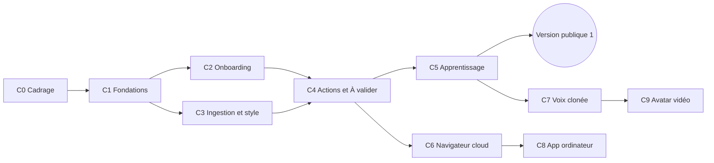

# 08. Les lots

Comme pour la plateforme : une branche et une PR par lot, des tests à chaque PR, rien en production sans « Fusionne et déploie » de Julien. Les lots du clone sont numérotés **C1 à C9** pour ne pas se mêler aux lots de la plateforme (1 à 11).

**La première version publique, « le clone qui écrit »** : C1 à C5. Elle trie, résume, répond comme le titulaire, gère son agenda, apprend de chaque correction. Le navigateur, la voix, l'app ordinateur et l'avatar viennent ensuite.

## C0. Le cadrage (ce dossier)

- Julien relit, corrige, tranche les questions ci-dessous.
- Une vraie veille concurrentielle (une demi journée), pour confirmer l'angle.
- Le choix d'un juriste.
- **Fini quand** : les questions marquées « avant C1 » sont tranchées et ce dossier est à jour.

## C1. Les fondations grand public

- Le métier `clone` dans `noyau/config.py` (configuration en version 2, section `clone`), son gabarit dans l'atelier.
- La confidentialité ([12-confidentialite.md](12-confidentialite.md)) : la passerelle unique des modèles, la sortie réseau fermée des conteneurs, les trois classes de données dans le schéma, le premier pool de modèles maison en zone Europe, les canaris.
- Le socle d'identité commun à tous les clones : aucun modèle nommé, ni dans les réponses, ni dans l'interface, ni dans le journal ; l'essai des vingt questions sur le modèle ([11-offre-locale.md](11-offre-locale.md)).
- Les vérifications de [09-infrastructure.md](09-infrastructure.md) (conteneurs, Durable Objects, Neon, service de clés, Exoscale), avant d'écrire le reste.
- Le noyau qui sert plusieurs titulaires depuis un même conteneur : configuration et outils chargés au début du tour, cache court, rien de propre à un titulaire dans l'état du processus ; le mode `MEGGA_SERVICE=clone`.
- Les trois nouveaux points d'échange du noyau : coordinateur, file (dans Postgres), clés ; leur version Cloudflare.
- La porte : le coordinateur par titulaire et le régulateur par zone (Durable Objects), le pool interactif et le pool de fond, la table `titulaires` de l'annuaire.
- La cellule 0 (équipe MEGGA et testeurs) : les tables du modèle de soi dans `noyau/stockage.py` (version de nos tables suivante), sécurité par ligne forcée, jeton signé de la porte, chiffrement par titulaire, export et effacement complets (destruction de la clé comprise).
- L'essai comparatif : schéma maison contre une bibliothèque de mémoire à graphe daté.
- L'atelier : inscription libre d'un titulaire, son clone créé par lui même, mise en service sans essai forcé pour le métier `clone`, quotas par titulaire.
- La console : comptes grand public (Better Auth est déjà là), double authentification.
- **Fini quand** : un titulaire s'inscrit seul, a un clone en service qui lui répond dans l'app et sur WhatsApp, et retient ce qu'il dit ; l'export et l'effacement marchent.
- **Essais** : isolation entre titulaires (un titulaire ne lit jamais une ligne d'un autre, même avec une requête volontairement fausse ; une valeur chiffrée recopiée sur la ligne d'un autre ne se déchiffre pas) ; charge (1 000 puis 10 000 titulaires simulés sur une cellule et un pool) ; un conteneur du pool tué en plein tour, le tour rejoué sans action en double ; export puis réimport ; effacement complet vérifié ; tout aussi sur SQLite.
- **La zone Suisse** (Exoscale) suit dans un lot à part, quand un premier titulaire suisse le demande : même image, versions Exoscale des trois points d'échange.

## C2. L'onboarding conversationnel

- L'agent d'accueil, ses consignes, ses outils d'écriture ([03-onboarding.md](03-onboarding.md)).
- Les écrans : conversation, cartes qui apparaissent, boutons de branchement, curseurs (CopilotKit et AG-UI, déjà dans la console).
- Le portrait v1, lisible et corrigeable.
- Les missions v1 tirées des corvées.
- Le branchement des comptes par le titulaire lui même (lien Composio, sans MEGGA).
- **Fini quand** : une personne qui n'a jamais vu le produit arrive au portrait et à son premier compte branché en moins de 15 minutes, sans aide.
- **Essais** : parcours de bout en bout (Playwright, modèle d'essai) ; dix entretiens simulés avec des personas variés, notés sur ce qui a été bien noté ; aucun mot de passe retenu ; abandon et reprise.

## C3. L'ingestion et le style

- L'ingestion par lots des mails envoyés et reçus, de l'agenda ; reprise après panne ; progression dans l'app ; plafond de coût par titulaire.
- L'extraction : faits, personnes, styles, exemples, décisions ; avec sources et certitudes.
- La consolidation de nuit v1 (doublons, certitudes, questions).
- Le dossier du tour (relecture du modèle de soi, budget de jetons, cache).
- Le premier service pendant l'onboarding (tri, trois brouillons).
- Le jeu « Qui a écrit ça ? ».
- Le sas de pseudonymisation et de ré-identification, le classement des données à l'ingestion ([12-confidentialite.md](12-confidentialite.md)) ; le jeu « Qui a écrit ça ? » mesure aussi l'écart de qualité dû à la pseudonymisation.
- **Fini quand** : sur une boîte mail d'essai, les brouillons ressemblent assez pour que le jeu soit perdu une fois sur deux par son propriétaire.
- **Essais** : boîtes mail synthétiques (avec tiers, langues, contextes) ; aucune donnée d'un titulaire dans les extraits d'un autre ; un mail piégé qui tente d'écrire dans le modèle de soi n'y écrit rien ; coût d'ingestion mesuré.

## C4. Les actions et la file « À valider »

- Porter sur `main` les approbations et le journal d'audit du lot 9.1.
- Le curseur d'autonomie (domaine par genre), les règles dures en langage naturel, le plancher si Julien le retient.
- La file « À valider » dans l'app et sur WhatsApp ; le point du jour.
- Le contrôle de cohérence séparé ; les sorties bornées ; le banc d'injections.
- Composio en libre service pour le titulaire, sur une liste sûre tenue par MEGGA, avec un plafond d'appels par offre ; le client MCP sur un catalogue fermé.
- Les connecteurs directs Gmail (notifications push), Google Agenda et Outlook (Microsoft Graph) : les plus sollicités, trop chers à l'appel chez Composio ([10-tarifs.md](10-tarifs.md)).
- Les crédits : poids de chaque genre de tâche, jauge dans l'app, alerte à 80 %, forfaits Free et Plus dans l'atelier (l'unité passe de la conversation au crédit), recharges Stripe.
- Le routage des modèles (Haiku d'abord, Sonnet quand il le faut, Opus à part) : la part de Haiku est la première mesure de rentabilité.
- Le journal lisible par le titulaire ; l'annulation quand le service la permet ; la pause.
- Le coût par mission, dans le relevé chiffré.
- **Fini quand** : un titulaire d'essai vit une semaine avec son clone sur ses mails et son agenda, avec au moins un domaine en « agir », sans aucune action hors permission.
- **Essais** : chaque combinaison du curseur ; le banc d'injections (aucune action provoquée par un contenu) ; une action non confirmée par le service n'est jamais dite faite ; pause immédiate.
- Les niveaux de confidentialité Standard et Strict, le journal de confidentialité dans l'app, la règle WhatsApp (aucune donnée sensible écrite sur WhatsApp).
- **Avant de commencer** : l'avis du juriste sur les points de [07-securite-conformite.md](07-securite-conformite.md).

## C5. L'apprentissage

- Chaque validation, retouche ou refus devient une règle de style, une décision ou un fait (avec contrôle des conflits).
- Les questions au titulaire dans le point du jour.
- La proposition d'autonomie (« 40 réponses validées sans retouche : je réponds seul à ce genre de mails ? »).
- Les mesures de ressemblance (distance d'édition, taux sans retouche) dans le relevé, en nombres.
- **Fini quand** : sur un mois d'essai, la distance d'édition baisse et le taux sans retouche monte, semaine après semaine.
- **Essais** : une correction répétée devient une règle ; une contradiction devient une question, jamais un écrasement ; un oubli efface aussi ce qui en a été déduit.

**Version publique 1** : après C5, sur décision de Julien. Avant : test d'intrusion par un prestataire, validation Google des accès Gmail, AIPD faite, conditions d'utilisation relues, prix fixé sur les coûts mesurés.

## C6. Le navigateur dans le cloud

- Le choix du fournisseur (zone, isolation, coût à la minute).
- Un navigateur isolé par tâche ; la fenêtre en direct pour que le titulaire se connecte ; le coffre des sessions et des identifiants ; les codes à usage unique demandés en direct.
- Les recettes : apprises, rejouées, réapprises ; les recettes communes sans donnée personnelle.
- La liste des sites exclus.
- **Fini quand** : le clone télécharge et range chaque mois les factures de trois espaces clients différents, sans aide après la première fois.
- **Essais** : sites d'essai locaux (formulaires, connexion, codes) ; une page piégée ne fait rien faire ; une recette cassée est réapprise ; aucun secret ne passe dans le contexte du modèle.

## C7. La voix clonée

- L'enregistrement en direct, la vérification, le consentement prouvé et retirable.
- Le point du jour et les vocaux avec la voix du titulaire ; la mention IA.
- Les appels téléphoniques simples, si Julien les met dans ce lot.
- **Fini quand** : un titulaire crée sa voix en moins de 5 minutes et reçoit son point du jour avec elle ; aucun fichier téléversé ne peut créer une voix.

## C8. L'app sur l'ordinateur

- L'app macOS et Windows, toujours sortante, ordres signés (le modèle du pilote), genres d'actions bornés, pastille et arrêt immédiat.
- Signature de code, notarisation, mises à jour signées.
- L'offre Local hybride ([11-offre-locale.md](11-offre-locale.md)) : noyau et modèle de soi (SQLite chiffré) sur la machine, modèle ouvert embarqué, orchestrateur qui répartit chaque étape entre la machine et le cloud, contrôle de qualité, veilleur et carnet de garde, renfort compté au coût réel, vérification de la machine à l'installation.
- **Fini quand** : le clone ouvre un logiciel installé, y fait une tâche simple, et range le résultat, sous les yeux du titulaire ; un titulaire Local ne voit aucune différence de style entre une tâche faite sur sa machine et une tâche faite dans le cloud, et son clone reste joignable machine éteinte.

## C9. L'avatar vidéo

- Le choix du fournisseur ; l'enregistrement en direct, le contrôle de présence, la vérification d'identité retenue avec le juriste.
- Les messages vidéo marqués ; plus tard, la présence en visio annoncée.
- **Fini quand** : un titulaire envoie un message vidéo de son avatar, marqué comme généré, à un destinataire de son choix.

## Toutes les questions ouvertes

### Avant C1 (Julien)

1. **L'infrastructure du grand public** : conçue par Claude à la demande de Thomas ([09-infrastructure.md](09-infrastructure.md)) ; Julien la valide ou la corrige, en particulier le régulateur maison des conteneurs et la file dans Postgres plutôt que Cloudflare Queues.
2. **Le secours de modèle d'un clone** : pas DeepSeek par défaut ; un autre Claude ou Claude par une autre voie ?
3. **Le nom public** : Clone, Double ou Twin ? (à tester auprès d'utilisateurs, n'empêche pas C1)
4. **Les tarifs** : la grille de [10-tarifs.md](10-tarifs.md) et ses cinq questions (prix du crédit, prix TTC égaux aux prix HT, ouverture de Pro, connecteurs directs, sauvegarde de l'offre Local). Les poids des crédits se recalent sur les coûts mesurés après C4.

5. **La confidentialité** ([12-confidentialite.md](12-confidentialite.md)) : le principe (rien en clair vers l'extérieur, la classe A jamais dehors), le coût fixe des modèles maison, l'hébergeur des cartes graphiques par zone.

### Avant C4 (Julien, Thomas, juriste)

5. **Le plancher de MEGGA** en v1 : oui ou non, quelles actions ([05-actions.md](05-actions.md)) ?
6. **La signature IA** des textes envoyés : réglage par défaut ([07-securite-conformite.md](07-securite-conformite.md)).
7. **Le rôle de MEGGA** au sens du RGPD et la base légale pour les données des tiers ; l'AIPD.
8. **MCP** : catalogue fermé ou serveurs ajoutés par le titulaire ?
9. **Composio** : le titulaire choisit ses outils dans une liste tenue par MEGGA ?

### Plus tard

10. Le schéma du modèle de soi (maison ou bibliothèque) : après l'essai de C1.
11. Le modèle d'embedding et sa zone.
12. La durée de garde des textes bruts (proposition : 30 jours).
13. La voix au téléphone : C7 ou plus tard ?
14. L'avatar : pièce d'identité ou contrôle de présence seul ?
15. Une app mobile : quand l'usage le demande.

## Ce qui ne change pas pour les agents d'entreprise

Rien de ce plan ne touche aux agents d'entreprise en service (Four Seasons, MEGGA Estates) : ils restent un conteneur et une base par client. Ce qui est ajouté au noyau (le métier `clone`, les tables du modèle de soi, le service de plusieurs titulaires) est inactif pour eux, et leurs tests restent verts à chaque PR.
