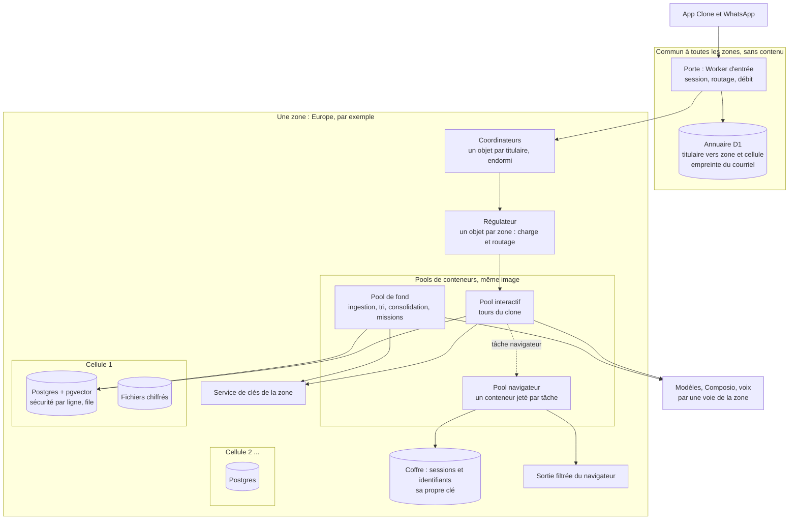
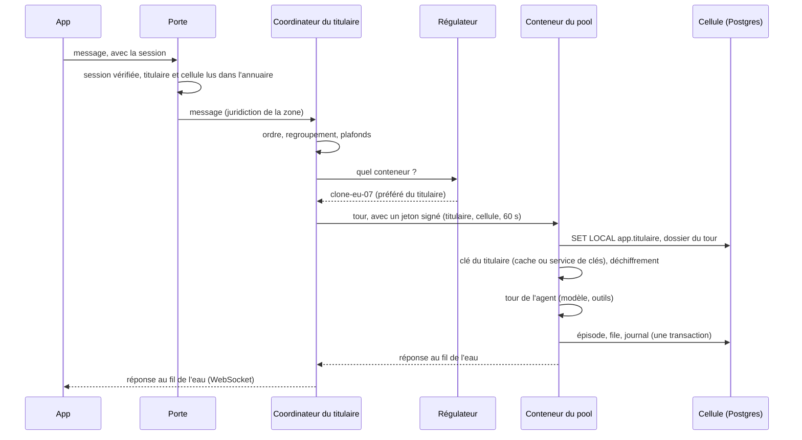

# 09. L'infrastructure cloud du grand public

Thomas a confié la conception de l'infrastructure à Claude (21.11.2026). Ce fichier est cette conception ; elle reste à valider par Julien, comme tout le dossier. Elle tranche la « grande décision » de [02-architecture.md](02-architecture.md) : **un calcul partagé et sans état, des données rangées par cellules, isolées par la base et par le chiffrement**.

## Ce que l'infrastructure doit tenir

| Exigence | Cible |
|---|---|
| Nombre de titulaires | 10 000 la première année, conçue pour 1 million sans changer d'architecture |
| Coût d'infrastructure (hors modèles) | quelques centimes par titulaire et par mois, au lieu d'environ 7 $ pour un agent d'entreprise |
| Réponse | jamais de démarrage à froid sur le chemin d'un message (aujourd'hui 1 à 2 minutes, `porte/src/agent.js`) |
| Isolation | un titulaire ne lit jamais une donnée d'un autre, même avec un bug dans le code de l'agent |
| Zones | Suisse, Europe, États-Unis, dès le premier jour ; rien ne sort de la zone du titulaire |
| Panne | une panne touche une cellule, jamais tous les titulaires ; perte de données au plus 5 minutes ; bascule sur la copie de secours en moins de 15 minutes, pour tenir 99,9 % de disponibilité (10) ; restauration complète en moins d'une heure |
| Effacement | réel et prouvable, sauvegardes comprises |
| Même image | la même image signée que les agents d'entreprise, dans un autre service (`MEGGA_SERVICE=clone`) |

## Les cinq idées de la conception

1. **Le calcul ne garde rien.** Un conteneur du pool sert n'importe quel titulaire de sa zone : il charge la configuration et la clé du titulaire au début du tour, et les oublie après (avec un cache court). On peut en ajouter, en retirer ou en redémarrer sans rien perdre.
2. **Un coordinateur par titulaire, qui dort.** Un petit objet par titulaire (un Durable Object chez Cloudflare, sans conteneur) range les tours dans l'ordre, tient les alarmes et les plafonds, et garde la connexion en direct avec l'app. Il ne coûte rien quand il dort, et il ne tient aucun contenu.
3. **Les données en cellules.** Une cellule, c'est une base Postgres et un préfixe de fichiers, pour quelques dizaines de milliers de titulaires d'une même zone. Quand une cellule est pleine, on en ouvre une autre. Une panne, une migration ou un incident reste dans sa cellule.
4. **Trois verrous l'un derrière l'autre.** Un jeton signé par la porte dit quel titulaire sert une requête ; la base n'en rend que les lignes (sécurité par ligne, forcée) ; et ces lignes sont chiffrées avec la clé du titulaire. Un bug doit passer les trois pour faire fuir quelque chose.
5. **Le noyau ne dépend toujours pas de Cloudflare.** Aux trois points d'échange du plan (entrée, base, fichiers), on en ajoute trois : le **coordinateur**, la **file** et les **clés**. Chacun a une version Cloudflare et une version pour la zone Suisse, derrière la même interface.

## Une zone, vue d'ensemble

## Les pièces, une par une

### La porte (Worker, déjà là)

Elle ajoute pour le clone :
- la vérification de la session de l'app (le jeton de Better Auth, ou un jeton court qu'il échange) ;
- la recherche du titulaire dans l'annuaire, puis l'appel au **coordinateur** de ce titulaire, dans sa juridiction (comme `getByName(client)` aujourd'hui) ;
- la limitation du débit avant tout réveil (règles de débit de Cloudflare par adresse et par compte) ;
- les webhooks des connecteurs (un nouveau mail chez Composio) : vérifiés, puis remis au coordinateur du titulaire, sans contenu gardé.

### L'annuaire (D1, déjà là, en juridiction UE)

Une table de plus, `titulaires` : identifiant opaque, zone, cellule, état, version de configuration. **Aucun nom, aucun courriel en clair** : pour retrouver un compte à la connexion, l'annuaire garde une empreinte du courriel (HMAC avec une clé de MEGGA), qui ne dit rien à qui la lit. Les comptes eux-mêmes (Better Auth) vivent dans la base de la cellule du titulaire, dans sa zone.

### Le coordinateur (un Durable Object par titulaire)

Sans conteneur, avec son petit stockage SQLite, dans la juridiction du titulaire. Il tient :
- **l'ordre** : un tour à la fois par conversation, les messages regroupés (comme les 2,5 s du noyau WhatsApp) ;
- **les alarmes** : missions planifiées, point du jour, rappels, relances de tâches en échec (le mécanisme d'alarmes qui se reposent elles-mêmes, déjà écrit pour les agents) ;
- **les plafonds** : tours par jour, coût du jour, minutes de navigateur ; au-delà, le titulaire est prévenu ;
- **la connexion en direct** avec l'app (WebSocket) : la réponse au fil de l'eau, les cartes de « À valider » qui arrivent ;
- **l'arrêt** : le bouton « Pause » met le coordinateur en « observer », tout de suite, sans attendre le pool.

Il ne garde **que des identifiants, des heures et des compteurs**. Tout contenu va dans la cellule. C'est aussi ce qui garde ouverte l'option C de 02 (un objet qui tient toutes les données) sans s'y enfermer.

### Le régulateur (un Durable Object par zone et par pool)

Le pool n'est pas « un conteneur par titulaire » : ce sont des conteneurs nommés (`clone-eu-00`, `clone-eu-01`...) que le régulateur tient éveillés.
- **Le routage** : chaque titulaire a un conteneur préféré, choisi par hachage cohérent de son identifiant sur les conteneurs en bonne santé, avec une charge bornée (si le préféré est trop chargé, le suivant). Un titulaire retombe donc presque toujours sur le même conteneur, dont le cache tient déjà sa configuration et sa clé.
- **La taille** : les conteneurs signalent leurs tours en cours toutes les 10 secondes. Comme un démarrage à froid prend 1 à 2 minutes, le régulateur **anticipe** : il garde 30 % de marge, suit la courbe de la journée de sa zone (plus de conteneurs à 8 h qu'à 3 h), et n'en retire un qu'après l'avoir vidé (la route `/interne/vider` existe déjà).
- **Les déploiements** : une nouvelle image se démarre à côté, reçoit d'abord les titulaires de la cellule d'essai, puis tous ; l'ancienne se vide.

Si Cloudflare propose un jour une mise à l'échelle automatique des conteneurs qui suffit, le régulateur se réduit au routage. À vérifier en C1.

### Les pools de conteneurs

| Pool | Ce qu'il fait | Taille (type d'instance) | Pourquoi à part |
|---|---|---|---|
| **Interactif** | les tours du clone : messages, brouillons, réponses en direct | le plus gros type utile, plusieurs dizaines de tours en même temps par conteneur (les tours attendent surtout les modèles) | ne jamais faire attendre un titulaire derrière une ingestion |
| **Fond** | ingestion, tri des nouveaux mails, consolidation de nuit, missions sans titulaire en ligne | même type, nombre variable | absorbe les pointes (une vague d'inscriptions) sans toucher l'interactif |
| **Navigateur** | les tâches sur les sites sans API (C6) | un conteneur par tâche, jeté à la fin | isolation forte : un site piégé ne voit qu'un navigateur vide, sans accès à la base |

Chaque conteneur d'un pool lance le noyau en mode asynchrone (FastAPI, Agno en `async`) ; le nombre de tours simultanés par conteneur se mesure en C1 (mémoire par tour, temps processeur des outils).

### La file (dans Postgres, la même partout)

Les tâches de fond sont des lignes d'une table de la cellule, prises par le pool de fond (`FOR UPDATE SKIP LOCKED`), avec reprise, délai et plafond par titulaire. Pourquoi pas Cloudflare Queues :
- **une seule façon de faire dans toutes les zones**, Suisse comprise ;
- **la tâche s'écrit dans la même transaction** que ce qui la provoque (un épisode, une mission) : jamais une action enregistrée sans sa suite, ni l'inverse ;
- **l'équité** : une ingestion de 2 000 mails ne bloque pas le tri des nouveaux mails d'un autre titulaire (tirage par titulaire, à tour de rôle) ;
- la file reste dans la zone et la cellule, comme la donnée qu'elle désigne.

Les longues tâches (ingestion) avancent par lots de quelques minutes, chaque lot noté comme fait : une panne reprend au dernier lot.

### Les cellules (Postgres, Neon en Europe et aux États-Unis)

- **Une cellule** : un projet Postgres dans la région de la zone (Francfort pour l'Europe, comme aujourd'hui), avec pgvector, et un préfixe de fichiers chiffrés (R2 en juridiction de la zone). Taille visée : 25 000 à 50 000 titulaires, à confirmer par l'essai de charge de C1.
- **Une nouvelle cellule** s'ouvre quand la précédente atteint 70 % de sa taille visée. Les nouveaux titulaires y vont ; personne ne déménage. Déménager un titulaire d'une cellule à l'autre (rééquilibrer, ou changer de zone) reprend l'outil d'export et d'import d'un client entier, prévu dans le plan.
- **Les tables** : celles du modèle de soi (04), les comptes (Better Auth), la file, le journal, les épisodes. Toutes portent `titulaire` en tête de leur clé et de leurs index.
- **La recherche par le sens, sans grand index commun** : un titulaire a quelques milliers de vecteurs (exemples, décisions). Les chercher **exactement**, parmi les siens seulement, prend quelques millisecondes, sans index approché partagé (qui filtrerait mal par titulaire et mélangerait les données dans une même structure). Les vecteurs sont rangés en demi-précision (`halfvec`) et en 512 dimensions si la qualité tient : quatre fois moins de place. À vérifier en C1 (version de pgvector chez Neon, qualité de la recherche).
- **Les connexions** : par le regroupeur de connexions de Neon, en mode transaction ; chaque transaction commence par `SET LOCAL app.titulaire`, ce qui marche dans ce mode.

### La sécurité par ligne

- Chaque table du titulaire a une règle : `titulaire = current_setting('app.titulaire')`. Elle est **forcée** (`FORCE ROW LEVEL SECURITY`), et le rôle de connexion du pool n'a pas le droit de passer outre.
- Le `titulaire` de la transaction ne vient **pas** du code de l'agent : il vient du jeton signé que la porte a remis pour cette requête, vérifié par le noyau dans `noyau/stockage.py`, le seul module qui parle à la base.
- Les tâches de fond prennent le `titulaire` de la ligne de la file, et ouvrent leur transaction avec lui.
- Un rôle à part, sans accès aux contenus, sert aux relevés chiffrés (des nombres seulement), et un autre aux migrations.

### Les clés : chiffrement par titulaire

- **Une clé de données par titulaire**, tirée à l'inscription, gardée dans sa cellule **chiffrée par la clé de la cellule**, qui ne sort jamais du service de clés de la zone.
- Les champs marqués « chiffré » dans [04-modele-de-soi.md](04-modele-de-soi.md) et tous les fichiers sont chiffrés avec la clé du titulaire (AES-GCM, avec l'identifiant du titulaire et de la ligne dans les données associées : une valeur copiée sur la ligne d'un autre ne se déchiffre pas).
- Le pool déchiffre la clé du titulaire au début de son tour, la garde 15 minutes au plus en mémoire, jamais sur disque.
- **Le coffre** (sessions et identifiants des sites) a **sa propre clé par titulaire**, que seul le pool navigateur peut faire déchiffrer : le pool interactif, donc le modèle, n'y a jamais accès.
- **Effacer un titulaire** : effacer ses lignes et ses fichiers, puis détruire sa clé de données. Ses données dans les sauvegardes deviennent illisibles sur-le-champ, sans attendre la fin de leur durée de garde (« effacement par destruction de la clé »).
- **Le service de clés** : un service géré dans la région de la zone, ou un service que nous tenons nous-mêmes (OpenBao, la reprise libre de Vault) ; à choisir en C1 zone par zone, avec la même interface dans le noyau (`noyau/cles.py` existe déjà pour les clés d'API : un module voisin, ou le même agrandi).

### Le pool navigateur et sa sortie

- Un conteneur par tâche, sans accès au réseau interne ni à la base : il reçoit la tâche et la session déchiffrée par un canal étroit, et rend des captures et un résultat.
- **Sa sortie passe par un relais filtrant** de la zone : la liste des sites exclus (07) y est appliquée, et le trafic sort par des adresses de la zone.
- La fenêtre en direct où le titulaire se connecte lui-même à un site passe par le coordinateur (WebSocket), jamais par une adresse publique du conteneur.
- Le service de navigateur de Cloudflare sera comparé en C6 à ce pool maison ; le critère est la zone, l'isolation et le coût à la minute.

### Les modèles et les services autour

- Les appels aux modèles ne partent **que par la passerelle des modèles** de la zone (12) : les conteneurs du clone n'ont aucune autre sortie vers un fournisseur. Elle envoie les données brutes au **pool de modèles maison** (des cartes graphiques dans la zone, deux au moins pour la disponibilité) et seulement du texte pseudonymisé à un modèle extérieur (Claude en direct, ou par AWS Bedrock en Europe), sans journal de contenu ni chez elle ni chez un intermédiaire.
- Composio : un projet par zone si Composio le permet (sinon, son traitement et ses régions à vérifier avant le premier titulaire de chaque zone, comme pour ElevenLabs dans le plan). Chaque titulaire y est un utilisateur, sous son identifiant opaque.
- Pas de secours chez un fournisseur que la zone n'autorise pas (voir 02, « Les modèles »).

## La zone Suisse

La même image, la même interface, chez Exoscale (décision de Julien du 15.11.2026 pour la zone) :

| Pièce | Cloudflare (Europe, États-Unis) | Exoscale (Suisse) |
|---|---|---|
| Entrée | la porte (Worker) | un répartiteur de charge Exoscale et un petit service d'entrée de la même image |
| Coordinateur | Durable Object par titulaire | service coordinateur : verrous par titulaire dans Postgres (verrous consultatifs), alarmes dans une table, WebSocket servi par lui |
| Pools | conteneurs nommés, régulateur | Kubernetes géré d'Exoscale (SKS), un Deployment par pool, mise à l'échelle automatique ; la chart Helm existe déjà (`installation/helm/`) |
| Cellules | Neon, Francfort ou États-Unis | Postgres géré d'Exoscale, avec pgvector (à vérifier), en Suisse |
| Fichiers | R2 en juridiction | stockage objet d'Exoscale en Suisse |
| Clés | service de clés de la zone | service de clés en Suisse (géré ou OpenBao chez Exoscale) |
| File | Postgres | Postgres (la même) |

L'annuaire (empreinte du courriel, zone, cellule) reste commun ; il ne porte aucune donnée personnelle lisible.

## Le chemin d'un message

Un nouveau mail suit le même chemin, depuis le webhook du connecteur jusqu'au coordinateur, qui pose une tâche de tri dans la file ; le pool de fond la prend. Une action à valider revient par le coordinateur vers l'app (carte) et vers WhatsApp (message à boutons).

## Le dimensionnement (ordres de grandeur, à mesurer en C1)

Hypothèses pour **100 000 titulaires**, dont 60 % actifs un jour donné : 15 tours de clone par titulaire actif et par jour, 40 nouveaux mails triés par un petit modèle, une consolidation de nuit.

| Charge | Calcul | Résultat |
|---|---|---|
| Tours du clone | 60 000 × 15 = 900 000 par jour, soit environ 10 par seconde, 40 en pointe ; 15 s par tour | environ 600 tours en même temps en pointe |
| Pool interactif | à environ 50 tours en même temps par conteneur, plus 30 % de marge | une quinzaine à une vingtaine de conteneurs |
| Tri des mails | 2,4 millions d'appels courts par jour, environ 30 par seconde, 2 s chacun | quelques conteneurs de fond |
| Ingestion | 1 000 inscriptions par jour × 2 000 mails, lus par lots de 20 | environ 100 000 appels par jour, étalés |
| Données | quelques dizaines de mégaoctets par titulaire après un an | quelques téraoctets, soit 2 à 4 cellules |

**Ce que ça coûte en calcul** : avec les prix relevés dans le plan (environ 27 $ par mois pour un conteneur « standard-1 » éveillé jour et nuit), une trentaine de conteneurs coûtent de l'ordre de 1 000 $ par mois. C'est environ **un centime par titulaire et par mois**, contre environ 7 $ avec un conteneur par titulaire. Les coûts qui dominent seront les **modèles** (de loin), puis le **stockage des cellules** et les **minutes de navigateur** : ils se mesurent dans le relevé chiffré dès C1, et le prix se fixe dessus (voir 01).

## La panne et la reprise

| Ce qui tombe | Ce qui se passe |
|---|---|
| Un conteneur du pool | le régulateur le retire ; les tours en cours sont rejoués par le coordinateur (chaque tour a un identifiant, une action déjà confirmée n'est jamais refaite) |
| Le fournisseur du modèle | le secours de la zone ; sinon, les tours attendent et le titulaire est prévenu ; aucune action n'est lancée à moitié |
| Composio | les tâches restent dans la file et reprennent ; le point du jour le dit |
| Une cellule | seuls ses titulaires sont touchés ; bascule sur la copie de secours de la base, déjà démarrée, en moins de 15 minutes ; sinon restauration à un instant donné (moins de 5 minutes de perte) en moins d'une heure. Les titulaires Ultra puis Pro repartent les premiers |
| Une zone entière de Cloudflare | les autres zones continuent ; pas de bascule vers une autre zone (les données n'en sortent pas) : on attend, et on le dit |

**Les sauvegardes** : la restauration à un instant donné du fournisseur, plus une copie logique chiffrée chaque jour dans un autre lieu **de la même zone**. Les copies restent lisibles 30 jours au plus ; un titulaire effacé y est illisible tout de suite, par la destruction de sa clé.

## Déployer sans casser

- **Une image**, construite une fois, signée, comme aujourd'hui ; le service `clone` est un mode de plus de la même image.
- **Une cellule d'essai** (cellule 0) : l'équipe MEGGA et les testeurs. Chaque version y passe d'abord, puis 10 % des cellules, puis toutes.
- **Les migrations** s'écrivent en deux temps (ajouter, puis retirer une version plus tard), pour que deux versions de l'image puissent servir la même cellule pendant le passage ; c'est la règle des deux versions soutenues, déjà dans le plan.
- **Rien n'est déployé sans « Fusionne et déploie » de Julien**, comme le reste.

## Ce que MEGGA voit, et ce qu'elle ne voit pas

- **Des nombres** : tours, actions par domaine et par genre, échecs, temps de réponse, coûts, minutes de navigateur, taille de la file, charge des pools, par titulaire (pour la facture) et par cellule (pour l'exploitation).
- **Jamais de contenu** : les journaux du Worker et des conteneurs ne portent ni texte, ni nom, ni courriel, ni numéro (règle déjà en place pour la porte) ; les traces techniques portent des identifiants opaques.
- **Les alertes** de la plateforme (`atelier/alertes.py`) s'étendent aux pools (charge, file en retard, cellule pleine à 70 %) et aux signaux de sécurité du clone (injection détectée, refus de la sécurité par ligne, clé demandée pour un autre titulaire).

## Ce qu'il faut vérifier en C1, avant de construire dessus

1. **Les conteneurs Cloudflare** : nombre d'instances par classe (50 aujourd'hui dans `porte/wrangler.jsonc`), types d'instances disponibles, temps de démarrage, coût d'un conteneur éveillé, existence d'une mise à l'échelle automatique.
2. **Les Durable Objects** en juridiction UE et États-Unis pour des centaines de milliers d'objets (déjà utilisés en juridiction pour les agents : le principe est acquis, le volume est à vérifier).
3. **Neon** : nombre de projets et taille par projet, regroupeur de connexions avec `SET LOCAL`, version de pgvector (`halfvec`), restauration à un instant donné, régions.
4. **Le service de clés** de chaque zone, et le coût d'un déchiffrement par tour (le cache de 15 minutes le rend rare).
5. **Exoscale** : Kubernetes géré, Postgres géré avec pgvector, stockage objet, service de clés en Suisse.
6. **L'essai de charge** : 1 000 puis 10 000 titulaires simulés sur une cellule ; tours simultanés par conteneur ; temps de la recherche par le sens exacte ; taille réelle d'un titulaire.
7. **L'essai d'isolation** : un code d'agent volontairement faux qui demande les lignes d'un autre titulaire n'obtient rien ; une valeur chiffrée recopiée sur la ligne d'un autre ne se déchiffre pas.

## Ce qui ne change pas pour les agents d'entreprise

Ils gardent leur conteneur, leur objet et leur base par client (`AgentEurope`, `AgentEtatsUnis`). Le clone ajoute de nouvelles classes à côté (coordinateur, régulateur, pools), et des modules qui ne s'activent que pour `MEGGA_SERVICE=clone`.
