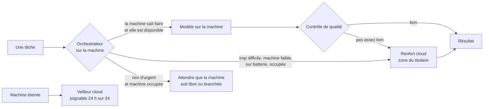

# 11. L'offre Local hybride, et une seule identité pour le clone

Demande de Thomas (21.11.2026), qui remplace l'offre Local de la première version de [10-tarifs.md](10-tarifs.md) :

1. **Le clone ne dit jamais sur quel modèle il tourne.** On voit une interface et un agent qui travaille, aucun détail technique. C'est vrai pour toutes les offres, pas seulement Local.
2. **La puissance se répartit sans couture entre la machine du client et le cloud**, de façon invisible pour lui.
3. **Le prix reste 5 par mois.**

## Une seule identité, sur toutes les offres

### Ce que voit le titulaire

- **Un nom et un visage** : son clone (le nom qu'il lui a donné, la mascotte ou son avatar), et la marque MEGGA. Jamais un nom de modèle, de fournisseur ou de version.
- **Aucun détail technique dans l'interface** : ni dans les réglages, ni dans le journal (« Votre clone a répondu à Julie »), ni dans les erreurs (« Je n'ai pas pu finir, je réessaie dans 5 minutes »), ni dans les factures (des crédits, pas des jetons).
- **Une même voix d'écriture**, quel que soit le modèle qui a travaillé : le style vient du modèle de soi (04), pas du modèle de langue. Le titulaire ne doit pas sentir de changement quand une tâche passe de sa machine au cloud.

### Ce que dit le clone si on lui demande

« Je suis votre clone, l'assistant IA que MEGGA a construit pour vous. Je ne donne pas de détails sur la technique qui me fait tourner. »

- **Il dit toujours qu'il est une IA** : c'est la loi (AI Act, article 50) et un principe du dossier.
- **Il ne confirme ni ne dément un modèle**, et ne prétend jamais en être un autre : se taire, oui ; mentir, non.
- La consigne est dans le socle de tous les clones, et un essai la vérifie à chaque PR (vingt façons de demander « tu es quel modèle ? », en plusieurs langues).
- **Pas de filtre sur les mots** « Claude » ou « Qwen » à la sortie : Claude est un prénom courant, et un titulaire peut parler d'un outil qu'il utilise. C'est la consigne qui tient l'identité, pas la censure.

### Ce que la loi et les licences demandent quand même

| Obligation | Où on la remplit, hors de l'interface principale |
|---|---|
| Dire que c'est une IA (AI Act) | toujours, dans le produit |
| Nommer les sous-traitants qui traitent les données (RGPD, nLPD) | la politique de confidentialité, qui liste les fournisseurs de modèles et leurs pays de traitement |
| Les licences des modèles ouverts installés sur la machine (Apache 2.0 pour gpt-oss, Qwen3, Mistral Small) | une page « Licences » de l'app, comme pour toute bibliothèque libre |
| Les conditions des fournisseurs de modèles | à relire par Julien : aucune n'oblige, à notre connaissance, à afficher le nom du modèle dans le produit |

**On écarte les modèles dont la licence impose une mention visible dans le produit** (la licence des modèles Llama, par exemple, demande d'afficher « Built with Llama ») : ils casseraient l'identité unique.

## La puissance sans couture

### Le principe

Le clone du titulaire Local vit sur sa machine : le noyau, le modèle de soi (SQLite chiffré), le coffre, le navigateur, et un modèle ouvert si la machine le porte. **Le cloud de MEGGA vient en renfort** pour ce que la machine ne sait pas faire assez bien, et **en veille** quand elle est éteinte. Le titulaire ne choisit rien et ne voit rien : il parle à son clone, son clone travaille.

### L'orchestrateur

Un petit module du noyau, sur la machine, décide pour **chaque étape** d'une tâche (pas pour la tâche entière) où elle tourne :

| Il regarde | Il choisit |
|---|---|
| La difficulté de l'étape (trier, résumer, extraire : facile ; rédiger comme le titulaire, agir sur un site, décider : plus difficile) | la machine pour ce qu'elle tient, le cloud pour le reste |
| Ce que la machine sait faire (mesuré à l'installation, puis appris : réussites du contrôle de qualité par genre d'étape) | plus la machine réussit un genre d'étape, plus elle le garde |
| L'état de la machine : sur batterie, carte graphique occupée (jeu, visio), chaude, en veille | le cloud si c'est urgent, sinon **attendre** que la machine soit branchée et libre |
| L'urgence : le titulaire attend (conversation), ou c'est du fond (ingestion, consolidation, missions de nuit) | le fond attend la nuit et la machine libre : c'est gratuit |
| Le budget de renfort du mois | quand il baisse, plus de travail reste sur la machine ou attend |

**Le contrôle de qualité** : quand la machine a produit un brouillon qui part vers un tiers, un contrôle rapide (le même petit modèle ou une règle) vérifie qu'il tient debout (destinataire, faits, ton, longueur). S'il doute, l'étape repart vers le cloud. Le titulaire ne voit que le bon résultat.

**Ce qui part dans le cloud** : seulement le dossier de l'étape (04, « Le dossier du tour »), jamais tout le modèle de soi, et selon la règle de [12-confidentialite.md](12-confidentialite.md) : **une donnée sensible (classe A) ne quitte jamais la machine** ; le reste va aux modèles maison de MEGGA dans la zone, ou pseudonymisé sur la machine avant d'en sortir s'il doit aller à un modèle extérieur. Rien n'est gardé après l'étape. La politique de confidentialité le dit clairement : l'offre Local n'est pas « rien ne sort jamais », sauf en réglage « Tout sur ma machine ».

**Pour qui veut que rien ne sorte** : un réglage avancé, « Tout sur ma machine », coupe le renfort et le veilleur. Le clone fait alors ce que la machine sait faire, et le dit quand il ne peut pas. Ce réglage est éteint par défaut.

### Le veilleur, quand la machine dort

Quand la machine est éteinte ou en veille, le clone reste joignable :
- il répond sur WhatsApp et dans l'app (« C'est noté, je m'en occupe dès que possible » ou une vraie réponse si c'est simple) ;
- il fait les missions à heure fixe qui ne demandent qu'un connecteur (envoyer un rappel, accepter un rendez-vous selon les règles du titulaire) ;
- il garde le reste en file, et la machine le reprend à son réveil.

Pour ça, le veilleur a besoin d'un **carnet de garde** : le résumé du portrait, les règles dures, les missions planifiées, les contacts utiles. Il est tenu à jour par la machine, chiffré, et rangé dans la cellule du titulaire (09). Tout le reste du modèle de soi reste sur la machine.

### Combien la machine fait toute seule

Pour un titulaire qui confie environ 300 tâches par mois (70 % faciles, 28 % moyennes, 2 % difficiles), avec un budget de renfort de **1,50 $ par mois** :

| Classe de machine (voir 10) | Part faite sur la machine | Coût du renfort pour 300 tâches | Tâches couvertes par le forfait |
|---|---|---|---|
| Légère (8 à 16 Go, pas de carte graphique dédiée) | environ 35 % | 5,12 $ | **environ 90** par mois |
| Entrée (Mac 32 Go, carte de 16 Go) | environ 80 % | 2,73 $ | **environ 165** |
| Confort (Mac 48 à 64 Go, carte de 24 à 32 Go) | environ 90 % | 1,59 $ | **environ 280** |
| Haut de gamme (96 à 128 Go et plus) | environ 96 % | 0,84 $ | **plus de 500** |

Les parts faites sur la machine sont des hypothèses, à mesurer en C8 sur de vraies machines et de vraies tâches. Le principe tient quel que soit le résultat : **plus la machine est puissante, plus le clone en fait pour 5 par mois.**

**Ce qu'on dit au titulaire** : à l'installation, l'app teste la machine et annonce, en mots simples, ce qu'elle permet (« Avec votre ordinateur, votre clone fera environ 160 tâches par mois dans votre forfait »). Pas de nom de modèle, pas de pourcentage local ou cloud.

**Quand le renfort du mois est épuisé** : le clone continue sur la machine, garde pour plus tard ce qu'elle ne sait pas faire, et propose une recharge (100 crédits pour 5) ou de passer à Plus. Il ne s'arrête jamais sans prévenir.

### Le renfort compté au coût réel

Dans les offres cloud, une tâche vaut 1 crédit, quel que soit le modèle (10). Pour Local, le renfort est compté **au coût réel** : un crédit vaut toujours environ 2 centimes de coût, mais une petite étape faite dans le cloud n'en consomme qu'une fraction. Sans ça, une machine faible qui envoie beaucoup de petites étapes au cloud viderait sa jauge pour presque rien. Le titulaire ne voit qu'une jauge « puissance du mois », sans unité technique.

| | Par mois |
|---|---|
| Renfort cloud inclus | 75 crédits au coût réel (1,50 $ de coût au plus) |
| Composio (longue traîne) | 50 appels |
| Relais (app mobile, WhatsApp entrant) | compris |
| Veilleur | compris, dans le renfort |
| Recharges | 100 crédits pour 5 |

## La rentabilité de Local

| | Par mois |
|---|---|
| Revenu net (5 TTC, TVA de 20 %, frais de paiement) | 3,74 $ (3,21 $ en annuel) |
| Coût fixe (relais, 50 appels Composio, sauvegarde chiffrée de 1 Go) | 0,27 $ |
| Coût au plafond (renfort entièrement utilisé) | 1,77 $, soit une **marge de 53 %** |
| Coût typique (environ la moitié du renfort) | 1,07 $, soit une **marge d'environ 72 %** |

Le prix annuel (48) fait baisser la marge au plafond à environ 45 % : à surveiller, mais positif.

**Ce que Local apporte à MEGGA au-delà des 5** : les titulaires attachés à leurs données, ceux qui ont une machine puissante, et un chemin naturel vers Plus quand ils voudront le navigateur dans le cloud, la voix ou plus de puissance sans laisser leur machine allumée.

## Ce qu'il faut construire (dans C8)

- L'orchestrateur, ses mesures de la machine, sa file d'attente « quand la machine sera libre ».
- Le contrôle de qualité avant tout envoi à un tiers.
- Le moteur de modèle ouvert embarqué dans l'app (servi localement, sans rien exposer sur le réseau), et le téléchargement des poids adapté à la machine.
- Le veilleur et le carnet de garde dans la cellule du titulaire.
- La jauge « puissance du mois » et le renfort compté au coût réel.
- Le socle d'identité commun à toutes les offres (ce bout-là dès C1, pour les offres cloud aussi).
- **Essais** : vingt questions sur le modèle en plusieurs langues, aucune réponse qui le nomme ni qui ment ; une même tâche faite sur la machine puis dans le cloud, jugée de même style par le jeu « Qui a écrit ça ? » ; machine coupée en plein travail, reprise par le veilleur sans action en double ; budget de renfort épuisé, aucune action perdue.

## Questions pour Julien

1. L'identité unique (aucun modèle nommé dans le produit) : d'accord, avec la liste des sous-traitants dans la politique de confidentialité ?
2. Le budget de renfort de Local à 1,50 $ par mois : d'accord, ou plus serré pour garder plus de marge ?
3. Le réglage « Tout sur ma machine » : le proposer, ou le garder pour plus tard ?
