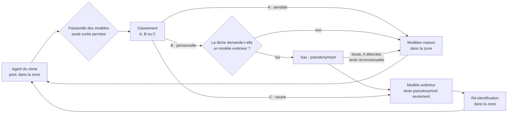

# 12. La confidentialité : les données du titulaire ne sortent pas en clair

Exigence de Thomas (21.11.2026) : le clone traitera des données sensibles ; elles doivent être cloisonnées, et **ne jamais aller vers un modèle de langue extérieur, sauf anonymisées**. Ce fichier est la stratégie qui le garantit par l'architecture, pas seulement par contrat. Il précise [07-securite-conformite.md](07-securite-conformite.md) et change le routage des modèles de [02-architecture.md](02-architecture.md) et [10-tarifs.md](10-tarifs.md).

## La stratégie en une phrase

**Les données brutes du titulaire ne quittent jamais sa cellule (ou sa machine) : elles sont traitées par des modèles que MEGGA fait tourner elle-même dans la zone ; un modèle extérieur ne reçoit que du texte pseudonymisé, jamais les données les plus sensibles, et toujours par une seule porte de sortie qui l'impose.**

Quatre pièces :

1. **Trois classes de données**, qui décident de ce qui peut sortir.
2. **Des modèles maison** dans chaque zone, pour tout ce qui touche aux données brutes.
3. **Un sas de pseudonymisation** avant tout appel à un modèle extérieur, et la ré-identification au retour, dans la zone.
4. **Une passerelle unique** vers tous les modèles, la seule sortie réseau permise aux conteneurs, qui applique la règle et refuse en cas de doute.

## 1. Les trois classes

| Classe | Ce qu'elle contient | Où elle peut être traitée |
|---|---|---|
| **A. Sensible** | santé ; numéros de compte, de carte, relevés et montants rattachés à une personne ; pièces d'identité et numéros officiels (AVS, sécurité sociale, passeport) ; voix et visage ; données d'enfants ; religion, opinions, orientation ; litiges et affaires juridiques ; identifiants et secrets | **modèles maison seulement** (ou la machine du titulaire en Local). **Jamais à l'extérieur, même pseudonymisée** : dans ces textes, le contexte suffit souvent à reconnaître la personne |
| **B. Personnelle** | tout le reste qui touche des personnes : mails ordinaires, agenda, contacts, modèle de soi, style | modèles maison ; ou un modèle extérieur **après pseudonymisation** |
| **C. Neutre** | rien de personnel : consignes du clone, recettes communes, pages publiques, textes génériques | partout |

**Comment une donnée reçoit sa classe** :
- **À l'ingestion** : un modèle maison et des règles (formats d'IBAN, de cartes, de numéros AVS ou de sécurité sociale, mots du vocabulaire médical ou juridique) classent chaque source, chaque mail, chaque fait. Le champ `sensible` du modèle de soi (04) devient la classe A.
- **Par source** : le titulaire peut marquer une source entière (« tout ce qui vient de ma mutuelle », un dossier Drive) ou un domaine (« finances ») comme sensible.
- **Par contagion** : un texte qui cite une donnée de classe A devient classe A pour le tour.
- **Dans le doute, la classe la plus haute.** Un classement incertain vaut A.

## 2. Les modèles maison

Dans chaque zone, MEGGA fait tourner ses propres modèles ouverts, dans son infrastructure (un pool de cartes graphiques à côté des pools de 09), sans aucun tiers qui voie les données :

| Rôle | Genre de modèle (familles en licence libre, à revalider au lot) |
|---|---|
| Classer, détecter les données personnelles, pseudonymiser | des détecteurs d'entités ouverts (par exemple GLiNER, Apache 2.0, avec les règles de Microsoft Presidio, MIT) et un petit modèle de langue |
| Trier, résumer, extraire, consolider, répondre aux tâches simples | un modèle de 20 à 30 milliards de paramètres (gpt-oss 20B, Qwen3 30B-A3B, Mistral Small : Apache 2.0) |
| Tâches de classe A plus difficiles (rédiger, décider, agir) | un modèle plus grand (gpt-oss 120B, ou l'équivalent du moment) |
| Lire les écrans du navigateur sur les sites sensibles | un modèle ouvert qui voit les images (variantes vision de Qwen3, par exemple) |
| Transcrire les vocaux | un modèle de reconnaissance de la parole ouvert (famille Whisper, MIT) |
| Les vecteurs du modèle de soi | un modèle d'embedding ouvert et multilingue |

Ce sont les mêmes familles que pour l'offre Local (11) : un seul jeu de modèles à éprouver. Aucun modèle dont la licence impose une mention visible (l'identité unique de 11 tient).

**Ce qu'ils remplacent** : presque tout le travail « simple » que le dossier confiait à Claude Haiku (le tri, l'extraction, l'ingestion, la consolidation, les embeddings, la transcription), soit la grande majorité des appels. Claude ne sert plus qu'à ce qu'il fait nettement mieux, et seulement sur du texte pseudonymisé.

**Plus tard, l'informatique confidentielle** : les cartes graphiques récentes savent faire tourner un modèle dans une enclave chiffrée, avec une attestation qui prouve que même l'exploitant ne peut pas lire la mémoire. À proposer pour la zone Suisse et l'offre Ultra quand les hébergeurs de la zone le permettent.

## 3. Le sas de pseudonymisation

Avant tout appel à un modèle extérieur, le sas (dans la passerelle, dans la zone) :

1. **Détecte** les personnes, organisations, adresses, courriels, téléphones, dates de naissance, numéros, lieux précis, montants ;
2. **Remplace** chacun par un jeton typé et stable **pour cette tâche seulement** : `[PERSONNE_1]`, `[ORGANISATION_2]`, `[ADRESSE_1]`. Les jetons changent d'une tâche à l'autre, pour qu'un fournisseur ne puisse pas relier les tâches d'un même titulaire ;
3. **Garde ce qui est utile sans identifier** : le lien (« [PERSONNE_1], son associé »), le genre grammatical quand la langue en a besoin (« [PERSONNE_1] est arrivée »), la langue, le ton à employer ;
4. **Généralise ce qui identifie par recoupement** : un métier rare, une petite commune, une date exacte deviennent « un artisan », « une ville de la région », « fin mars » quand la tâche n'en a pas besoin ;
5. **Envoie**, puis **ré-identifie** la réponse dans la zone : chaque jeton reprend sa vraie valeur, avant que quoi que ce soit parte vers le titulaire ou un tiers.

**La table de correspondance** (jeton et vraie valeur) ne quitte jamais la cellule, chiffrée avec la clé du titulaire (09), et s'efface à la fin de la tâche.

**Quand la tâche a besoin de la vraie valeur** (remplir un formulaire avec une adresse, écrire à une personne par son prénom) : le modèle extérieur raisonne sur le jeton (« mettre [ADRESSE_1] dans le champ Adresse », « Bonjour [PERSONNE_1], ») ; ce sont nos outils, dans la zone, qui posent la vraie valeur. C'est le même principe que le coffre pour les mots de passe (05).

**Le style du titulaire** : ses exemples d'écriture passent aussi par le sas. Ce qui fait le style (longueur, formules, ponctuation, ton) survit à la pseudonymisation ; ce qui identifie, non.

**Ce que le sas refuse** : si la détection est incertaine, si une donnée de classe A apparaît, ou si le texte, une fois pseudonymisé, reste reconnaissable (un récit très singulier), la tâche repart vers un modèle maison. **Il ne laisse jamais sortir un texte brut faute de mieux.**

## 4. La passerelle unique

- **Les conteneurs du clone n'ont aucune sortie réseau directe** vers un fournisseur de modèles : leur trafic sortant ne passe que par la passerelle (modèles) et par le relais filtrant (connecteurs, navigateur, voir 09). Un bug ou une injection dans l'agent ne peut pas « appeler Claude en direct ».
- **La règle est écrite comme du code**, versionnée dans le dépôt, testée à chaque PR, et la même dans toutes les zones.
- **Le journal de la passerelle** ne garde aucun contenu : titulaire (identifiant opaque), classe, route (maison ou extérieure), nombre d'entités remplacées, jetons consommés, refus du sas. Ces nombres alimentent le relevé chiffré et les alertes (une hausse des refus, un envoi extérieur de classe A, qui doit rester à zéro).
- **Elle échoue fermée** : passerelle, sas ou modèles maison en panne, rien ne part dehors ; la tâche attend ou passe à un modèle maison de secours.

## Les autres sorties de données, une par une

Les modèles de langue ne sont pas les seuls tiers qui voient des données. Même règle pour chacun :

| Sortie | Ce qu'elle voit | La règle |
|---|---|---|
| **Navigateur** (C6) | des pages et des captures d'écran avec des données brutes | d'abord les **recettes rejouées sans modèle** (aucune donnée ne sort) ; sinon la page lue comme texte et pseudonymisée ; une capture envoyée dehors seulement après masquage des zones détectées (lecture du texte de l'image par un modèle maison) ; **banque, santé, impôts, assurances : modèle de vision maison seulement** |
| **Voix** (vocaux, point du jour, voix clonée) | le texte à dire, en clair (on ne peut pas faire dire un jeton), et l'empreinte de la voix | un modèle de voix maison quand sa qualité suffit ; sinon le fournisseur de voix dans sa zone, en mode sans conservation (à négocier), et jamais pour un texte de classe A |
| **Transcription** | la voix du titulaire et ce qu'il dit | modèle maison, toujours |
| **Avatar vidéo** (C9) | le visage et le texte | fournisseur extérieur avec consentement exprès, textes de classe A exclus ; un modèle maison quand il en existe un de qualité |
| **Composio** | le contenu des appels d'outils | longue traîne seulement, sur des services sans données de classe A ; Gmail, Agenda, Outlook, Drive en connecteurs directs (10) |
| **WhatsApp** | les messages échangés entre le titulaire et son clone (Meta les traite) | le clone n'y écrit pas de données de classe A : il résume (« votre relevé est arrivé ») et renvoie vers l'app ; réglable par le titulaire |
| **Vecteurs** | tout le modèle de soi | modèle d'embedding maison |

## Ce que le titulaire voit et règle

- **Un niveau de confidentialité**, par domaine ou pour tout le clone :
  - **Standard** (par défaut) : la règle de ce fichier ; un modèle extérieur ne voit que du pseudonymisé, jamais de classe A ;
  - **Strict** : rien ne sort, même pseudonymisé ; tout passe par les modèles maison (quelques tâches difficiles seront moins fines ou plus lentes, et le clone le dit) ;
  - **Ma machine** (offre Local) : rien ne quitte la machine (le réglage « Tout sur ma machine » de 11).
- **Le journal de confidentialité**, dans l'app : pour chaque tâche, si elle est restée chez MEGGA ou si un « partenaire IA externe » a vu une version pseudonymisée, et combien d'éléments ont été masqués. Sans nommer le modèle (l'identité unique de 11) ; la politique de confidentialité, elle, nomme les sous-traitants.
- **Marquer une source ou un domaine comme sensible**, en un geste ou en langage naturel (« tout ce qui touche à ma santé reste entre nous »).

## Ce que ça garantit, et ce que ça ne garantit pas

**Garanti par construction** : aucun texte brut du titulaire, ni aucune donnée de classe A, ne part vers un modèle extérieur ; un conteneur compromis ne peut pas contourner la passerelle ; un fournisseur ne peut pas relier les tâches d'un titulaire par les jetons.

**À dire honnêtement** :
- **La pseudonymisation n'est pas l'anonymisation au sens du RGPD** : MEGGA garde la correspondance, donc les données restent personnelles pour nous, et le fournisseur extérieur reste un sous-traitant sous contrat (accord de traitement, aucune conservation, aucun entraînement, voie de la zone). La CJUE a jugé en 2025 (affaire du Conseil de résolution unique) que des données pseudonymisées peuvent ne pas être personnelles pour un destinataire qui n'a aucun moyen raisonnable de ré-identifier : un argument fort pour nous, **à faire confirmer par le juriste**.
- **Aucune détection n'est parfaite** : un nom mal écrit, un surnom, un détail très singulier peut passer. D'où le classement prudent, la classe A qui ne sort jamais, le refus en cas de doute, et les essais ci-dessous.
- **La qualité a un prix** : un modèle extérieur qui voit `[PERSONNE_1]` écrit presque aussi bien, mais pas toujours (un prénom porte un ton, une culture). Le jeu « Qui a écrit ça ? » (03) mesure l'écart, tâche par tâche.

## Ce que ça coûte

| Poste | Ordre de grandeur (hypothèses, à mesurer en C1) |
|---|---|
| Une carte graphique de classe H100, louée | environ 2,5 $ de l'heure, soit environ 1 800 $ par mois |
| Deux cartes par zone au minimum (la disponibilité de 99,9 % de 10), trois zones | environ 10 800 $ par mois de coût fixe au départ |
| Ramené au titulaire | environ 1,08 $ par mois à 10 000 titulaires, 0,11 $ à 100 000, 0,01 $ à un million |
| Contre Claude Haiku pour le même travail simple | à un débit moyen de 500 jetons écrits par seconde, une carte coûte autant que Haiku ; à 1 500, trois fois moins ; en dessous, plus cher |

**Conséquence** : au lancement, le pool maison coûte plus cher que de tout envoyer à Haiku, parce que les cartes tournent à moitié vide ; c'est le prix de la promesse « vos données ne sortent pas ». Quelque part entre 10 000 et 50 000 titulaires actifs (selon le débit réel des cartes, à mesurer), il devient moins cher. Les poids des crédits (10) ne changent pas ; le coût fixe des cartes entre dans les coûts fixes à couvrir. La zone Suisse demande des cartes chez un hébergeur suisse (Exoscale ou un autre, à vérifier).

## Les essais, à chaque PR

- **Les canaris** : des boîtes mail d'essai truffées de fausses données reconnaissables (faux IBAN, faux numéros AVS, faux noms rares, faux diagnostics). Une sonde capture tout ce qui sort de la zone : **aucun canari ne doit y apparaître**, jamais.
- **Les pièges** : des textes faits pour tromper la détection (noms dans des adresses de courriel, surnoms, fautes, langues mélangées) ; le taux de fuite doit rester à zéro sur la classe A et sous un seuil fixé sur la classe B.
- **La sortie fermée** : un conteneur du clone qui appelle un fournisseur en direct est bloqué par le réseau.
- **La panne** : sas ou modèles maison coupés, aucun envoi extérieur, les tâches attendent.
- **La qualité** : le même lot de tâches, pseudonymisé ou non, jugé par le jeu « Qui a écrit ça ? ».

## Ce qu'il faut construire, et quand

| Lot | Ajout |
|---|---|
| C1 | la passerelle unique, la sortie réseau fermée des conteneurs, les trois classes dans le schéma, le journal sans contenu, les canaris |
| C1 | le premier pool de modèles maison dans la zone Europe (classement, détection, embeddings, transcription, tâches simples) |
| C3 | le sas de pseudonymisation et de ré-identification, le classement à l'ingestion, la généralisation des détails qui identifient |
| C4 | les niveaux Standard et Strict, le journal de confidentialité dans l'app, la règle WhatsApp |
| C6 | les règles du navigateur (recettes sans modèle, masquage des captures, sites sensibles en vision maison) |
| C7 | la voix : modèle maison ou fournisseur sans conservation, jamais de classe A |
| C8 | les mêmes règles pour le renfort de l'offre Local |

## Questions pour Julien

1. Le principe : aucun texte brut vers un modèle extérieur, la classe A jamais dehors, même pseudonymisée. D'accord ?
2. Le coût fixe des modèles maison (environ 10 800 $ par mois pour trois zones au départ) : l'accepter dès le lancement, ou ouvrir d'abord la seule zone Europe ?
3. L'hébergeur des cartes graphiques par zone (souveraineté en Europe et en Suisse), et plus tard l'informatique confidentielle.
4. Le niveau Strict : dans toutes les offres, ou à partir de Pro ?
